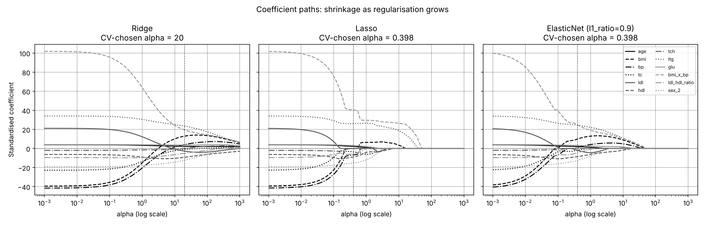

# Diabetes Progression Regression

Applied AI/ML mini project (Problem 17) — predicting diabetes disease progression one year after baseline
from ten baseline measurements, using `sklearn.datasets.load_diabetes` (442 patients).

[Open the notebook in Google Colab](https://colab.research.google.com/drive/1b750JkYeiisxDnfrFAzUkW90f1I-YSvb)

## Focus requirement
Compare Ridge, Lasso and ElasticNet and show how coefficients shrink as regularisation grows.

## Approach
- 60 / 20 / 20 train / validation / test split, stratified on target quintiles, seed 42
- One scikit-learn `Pipeline`: engineered features (`bmi_x_bp`, `ldl_hdl_ratio`), imputation, one-hot encoding, scaling —
  all fitted on training data only
- Models: mean baseline, OLS, Ridge, Lasso, ElasticNet, random forest, gradient boosting
- Tuning with 5-fold × 3-repeat cross-validation on the training set; test set used once

## Results

| Model | CV RMSE | Val RMSE | Val R² |
|---|---|---|---|
| Baseline (mean) | 76.72 | 77.75 | 0.000 |
| OLS | 55.69 | 56.49 | 0.472 |
| Ridge (α = 19.95) | 55.45 | 55.84 | 0.484 |
| **Lasso (α = 0.398)** | **55.32** | 55.88 | 0.483 |
| ElasticNet (α = 0.398, l1_ratio = 0.9) | 55.39 | 55.79 | 0.485 |
| Random forest | 56.71 | 57.06 | 0.461 |
| Gradient boosting | 57.01 | 56.91 | 0.464 |

**Final model (Lasso), untouched test set:** RMSE 52.21 · MAE 41.63 · R² 0.548 (baseline RMSE 77.65).



Ridge shrinks all twelve coefficients smoothly and keeps them all; Lasso removes features one at a time, keeping
`bmi_x_bp`, `ltg` and `bmi` longest; ElasticNet (l1_ratio 0.9) sits in between.

## Repository contents
- `diabetes_progression_regression.ipynb` — the full notebook, executed, with outputs
- `report/` — the project report (.docx and a PDF copy)
- `figures/` — plots saved by the notebook
- `tools/` — scripts used to build the notebook, render screenshots and assemble the report

## Run it
Open the notebook in Colab and choose **Runtime → Run all** (about 2–3 minutes on CPU), or locally:
```bash
pip install -r requirements.txt
jupyter notebook diabetes_progression_regression.ipynb
```
